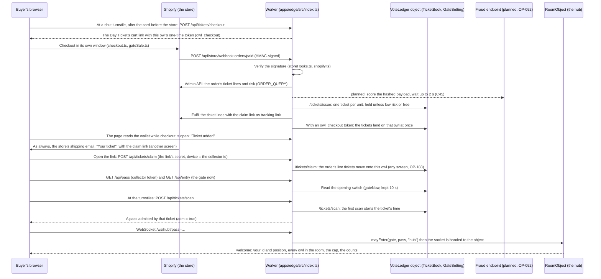

# Owl Park architecture

- Status: mixed; each section is tagged BUILT or PLANNED (OP-xxx)
- Verified against: main 8a1bbb9 (2026-10-23, the pad OP-082, quests in the Menu OP-083 and the mirror OP-077 merged)
- Code: apps/edge/src, packages/shared/src, apps/park/src, apps/edge/wrangler.jsonc, .github/workflows
- Tickets: OP-002, OP-010, OP-022, OP-048, OP-051, OP-055, OP-065, OP-067, OP-068, OP-071, OP-077, OP-082, OP-083, OP-098; planned OP-024, OP-050, OP-052, OP-053, OP-063, OP-072, OP-075, OP-076
- Related: docs/CAPACITY.md, docs/DEPLOY.md, docs/PLAYBOOK.md, docs/GLOSSARY.md

How to read this file: headings carry [BUILT] or [PLANNED (OP-xxx)]; inside a section, `PLANNED (OP-xxx)` marks
what does not exist on `main` yet. Grep `PLANNED` for everything unbuilt. Version 1 was presence only; the park now has quests, collectibles, a shop,
activities, nests, prewritten chat, the lobby and tickets, the home screen and the keepers' pages.
This document names no unreleased realm names and no reference products; the detailed
reverse-engineering notes behind it live in the team's internal drive, not in this public
repository. Where this file and a Done ticket or the code disagree, the Docs hat files a Finding
ticket rather than guessing (`docs/agents.md`).

Sections: 0 the repository · 1 what we replicate · 2 the decision · 3 components and cost ·
4 the wire protocol · 5 room data · 6 scaling and capacity · 7 the Realm Vote · 8 collectibles
and quests · 9 the lobby, tickets and the home screen · 10 feedback · 11 prewritten chat ·
12 the fraud link (planned) · 13 operations · 14 from a ticket purchase to the hub (a diagram) ·
15 open questions.

## 0. The repository

A pnpm monorepo (`pnpm-workspace.yaml`): `apps/`, `packages/` and `tools/`. Node 22 and pnpm 10.

| Package | What it is | Entry points |
| --- | --- | --- |
| `apps/park` (`@owl-park/park`) | The browser client: Vite + TypeScript + Phaser 3. Scenes, the owl, rooms, the HUD (DOM), the home screen, the transports, the collection service, the browser tests (`e2e/`) | `src/main.ts`; `pnpm dev`, `pnpm build`, `pnpm e2e` |
| `apps/edge` (`@owl-park/edge`) | The Cloudflare project: the Worker (`src/index.ts`, the router), three Durable Objects (`RoomObject`, `VoteLedger`, `Collections`), the ticket book, the store link, the keepers' pages under `/admin/*`, `wrangler.jsonc` | `pnpm dev:edge`, `pnpm deploy:edge`; `pnpm --filter @owl-park/edge exec wrangler <command>` |
| `packages/shared` (`@owl-park/shared`) | Rules with no platform code, shared by the client and the server and unit-tested in Node: the wire protocol (`src/edge.ts`), geometry and walks, room data (`rooms/index.ts`), collectibles, quests, the shop, activities, nests, phrases, feedback limits | imported by both apps |
| `tools/` | `build-edge.mjs` (the client build for the room server, on any shell), `render-svg.mjs`, `load/` (the bot swarm and the stepped load test), `art/` (the Seedream pipeline, `docs/ART-PIPELINE.md`), `dev/` (debug scripts), `cloudflare-skills.sh` | `pnpm build:edge`, `pnpm load`, `pnpm art:*` |

The Worker serves the built client as static assets from `apps/park/dist` and runs the API, the
sockets and the keepers' pages first (`run_worker_first` in `wrangler.jsonc`). Checks before a push:
`pnpm check` (typecheck, unit tests, build) and `pnpm e2e`. The edge typecheck runs `wrangler
types` first; `apps/edge/worker-configuration.d.ts` is generated and ignored by git, so `Env`
bindings change in `wrangler.jsonc`, never by hand (`CLAUDE.md`). Deploys: `docs/DEPLOY.md`.

## 1. What we replicate from the classic tap-to-move room worlds

The 2000s browser worlds that Owl Park takes its feel from all shared one simple model,
and so does Owl Park:

| Mechanic | Classic model | Owl Park |
| --- | --- | --- |
| Rooms | A fixed-size painted stage per room with a hidden "block" layer marking where an avatar may not stand, a foreground layer drawn in front of avatars, and trigger zones that lead to other rooms | A room of one or more 1600 x 900 screens (the hub and the grove three, the market and the lobby two) with `walkable` polygons, optional foreground images, and `doors` (trigger rectangles) in `packages/shared/rooms` |
| Movement | Click a spot; the avatar walks there in a straight line at constant speed; the client sends only the destination and every other client animates the same walk itself | Tap; `resolveTarget` snaps the tap into the walkable area and stops at the first blocked sample; one `move` message carries the target; every client animates from (from, to, startedAt) with `positionAlongWalk` |
| Depth | Avatars and props sorted by their y coordinate | `depth = y` for owls and set pieces; foreground always on top |
| Entering a room | Spawn near a named point with a little random scatter so avatars do not stack | Named `spawns`; the room server scatters new arrivals (door entry 60 px, map entry 220 px) |
| Doors | Walking into a trigger zone changes room and places you at a spawn in the destination | `doors[].to = { room, spawn }`; closed doors show an approved sign instead |
| Server | An authoritative room server per world with room caps (around 80 to 120), one connection per player, join/leave/move messages | One Durable Object per park (or per room) with caps, validation, rate limits and fan-out |

Deferred, exactly as the originals did it later: chat, names, mini-games. Emotes and inventories
arrived with the collectibles (section 8 and `docs/COLLECTIBLES.md`).

## 2. Decision: an authoritative room server at the edge

Three architectures were proposed and scored independently (cost at 20 / 200 / 2,000
concurrent visitors, time to a playable v1, operations burden, path to ticket gating,
movement feel, licensing):

1. **Serverless first**: Supabase Realtime as the transport (Presence + Broadcast), no server code.
   Lost on cost: Realtime bills one message per sender plus one per recipient, so a 20-owl room
   tapping normally uses ~4 million messages a month against a 2 million free quota, and 200
   concurrent is roughly $300 a month at the plan's 500 messages-per-second ceiling. Nothing is
   validated server-side.
2. **Classic Node WebSocket server** on a free host (Render, Fly, Oracle). Best game feel, but
   free hosts spin down or have no free tier any more, and someone must babysit a process.
3. **Edge room server**: one Cloudflare Worker serving the client as static assets and
   upgrading `/ws/<room>` to a WebSocket held by a Durable Object using the hibernation API.
   Incoming WebSocket messages are billed 20:1, outgoing messages are free, idle objects cost
   nothing, and the Workers free plan covers the first ~20 concurrent visitors; $5 a month
   covers hundreds. **Chosen.**

The client keeps a transport interface, so all three exist in the repository:

| Transport | Backend | Use |
| --- | --- | --- |
| `local` | none (BroadcastChannel between tabs) | development, demos on one device, tests |
| `supabase` | Supabase Realtime public channels | a small start with the team's existing account; no server code; message costs grow with room size |
| `edge` | the room server in `apps/edge` | the production path; authoritative, cheap at scale |

## 3. Components and licences

| Component | Choice | Licence |
| --- | --- | --- |
| Client | Phaser 3.90, Vite 8, TypeScript 5.9 | MIT / MIT / Apache-2.0 |
| Shared rules | `packages/shared`: protocol, geometry, walk maths, room data | MIT (this repo) |
| Room server | `apps/edge`: Worker + Durable Object; `workerd` runtime | code MIT; workerd Apache-2.0; the hosted service is proprietary |
| Static hosting | Workers static assets (free, unlimited) or GitHub Pages | service |
| Identity | An anonymous collector token per device, and an HMAC-signed guest "park pass" minted by the Worker (`apps/edge/src/pass.ts`); see "Identity" in section 9 | our code |
| Collections | `Collections` Durable Object (SQLite) keyed by the collector token; rules in `packages/shared/src/book.ts` | our code |
| Tickets and votes | The ticket book and the Realm Vote ledger in the `VoteLedger` Durable Object (SQLite): `apps/edge/src/TicketBook.ts`, `Ledger.ts`; the opening switch beside them (`gateSwitch.ts`) | our code |
| The store | Shopify sells tickets and passes and keeps the buyer; the Worker signs in with a Dev Dashboard app's client credentials (`storeApi.ts`) and takes signed webhooks at `/api/store/webhook` (`storeHooks.ts`) | service |
| The fraud link | PLANNED (OP-052, OP-053, OP-072): the owner's fraud pipeline scores every paid ticket order before release (section 12) | our code / the owner's pipeline |
| CI | GitHub Actions, Playwright | service / Apache-2.0 |

### Cost model (room server, assumptions: visitor-hours per day = 8 x peak; ~30 billed object requests per visitor-hour)

| | 20 peak | 200 peak | 2,000 peak |
| --- | --- | --- | --- |
| Durable Object requests per day | ~6k to 9k (6 to 9 % of the 100k free cap) | ~48k to 77k | ~0.5M to 0.75M |
| Object duration | one object, under the 13,000 GB-s per day free cap | one object, within free; on Paid well under the included 400k GB-s per month | sharded per room instance, ~2M to 6.5M GB-s per month |
| **Cloudflare bill** | **$0** | **$5** (Workers Paid) | **~$26 to $85 per month** |

The free plan fails closed at the daily cap (the park goes dark at 00:00 UTC rather than
degrading), so the runbook is: set a usage alert at 50 % and buy Workers Paid ($5) before
the first promoted weekend.

## 4. Wire protocol v8 (`packages/shared/src/edge.ts`)

One WebSocket per visitor to `wss://<host>/ws/<room>?pass=<park pass>`. Every frame is one
JSON object of at most 1 KiB, except the literal heartbeat text frame `hb`, which the
Durable Object answers without waking. Coordinates are integers in room space. All timestamps
are server milliseconds; clients never put their own clock on the wire.

Client to server: `hello` (once, within 5 s; look, optional spawn name and resume position),
`move` (target and a per-connection `seq`), `look` (new colours, species and worn items), `emote`
(an owned emote's id, or `jump`, the hop every owl has, OP-082), `say` (a prewritten phrase's number), `bye`, and the quest requests, each with a request number `r`: `quests`, `talk`,
`accept`, `abandon`, `handin`, `use` (an interactable) and `gather` (a quest item); and `act` for
the activities (light a lantern, cast and reel, the robot owl's copy game, today's tasks); and for
the nests `street` (on the street: the visitor's own nest and five other owls' open ones) and
`nest` (in its own nest, the owner puts a piece in a spot, takes one away, or opens or closes it).

Server to client: `welcome` (your id and position, every owl in the room with any walk in
progress, server `now`, room cap, park counts), `enter`, `move` (validated walk, sent to
everyone including the sender; only the sender's copy carries `seq`, which is the
acknowledgement), `look`, `leave`, `counts`, `full`, `emote` and `say` (to everyone else in the room), and
for quests `quests` (the board, as an answer or a push), `handin`, `useResult`, `refused`, plus
`objects` and `used` for shared interactables such as leaf piles (see `docs/QUESTS.md`), and for
the activities `act` (the answer), `lanterns`, `quiz`, `paid` and `tasks` (see
`docs/ACTIVITIES.md`), and for the nests `street` (the answer), `nest` (a nest as it stands: to a
newcomer after its welcome, to everyone inside when its owner changes it, and as the answer to the
change) and `closed` (a nest turned the visitor away or closed with it inside; close 4011 follows).

Server rules: moves are clamped with the same `resolveTarget` the client uses, so echoes
normally match the client's prediction; a walk in progress is continued from its current
point when redirected; moves use a token bucket (burst 5, refill 2 per second) and repeated
excess closes the socket (4003); more than 40 frames in 5 s closes it; a second session for
the same visitor replaces the first (4005); full rooms answer `full` then close (4010);
idle sockets (no heartbeat for 90 s) are reaped by a one-minute alarm; at most 8 sockets per
client address per object (`MAX_SOCKETS_PER_IP` in `wrangler.jsonc`; the default in
`apps/edge/src/RoomObject.ts`). Quests and collectibles: talks, uses and hand-ins count only within reach
of the owl's position on the server clock (plus 40 px of slack), a quest item only within 56 px,
and one quest request runs at a time per visitor; one use per 1.2 s; worn items the visitor's
collection does not hold are dropped from a look before it is broadcast; emotes must be owned and
are limited to one per 1.5 s, and the hop (`jump`, no collection asked) to one per 480 ms apart
from them (`jumpEveryMs`); a phrase must be one of the list's, one per 3 s per owl (any other
number is dropped, and a `say` frame with words in it closes the socket as malformed); quest,
emote and phrase frames count toward the frame limit. Nests: a nest's
room is `nest-<nestId>`, the id random and never taken from the collector; its hello waits for the
collections object (later frames wait behind it), a closed nest lets in only its owner, its owner
gets in however full it is (12 others), only its owner changes it (one change per 250 ms), and
closing it sends every visitor out. No frame carries a collector id, and counts sum all the nests
under one `nests` key.

Client rules: the clock offset is set from `welcome` and refined with a min-filter over
later `move` frames; remote owls are drawn 100 ms behind server time so jitter never shows;
the local owl walks immediately on the tap and is corrected only if the echo differs by more
than 2 px; reconnects back off from 0.5 s to 8 s and resume near the last position; a stale
bundle (protocol mismatch) reloads itself, once until a room welcomes it again.

Everything about a visitor that must survive hibernation (id, look, position, walk, collector id,
and in a nest whether it is the owner's) is kept in the socket attachment, so an object that was
evicted rebuilds every room, nests included, from its sockets. Used-up leaf piles, the hub's
lantern beam and the last stage quiz round paid are kept in the object's storage as well, so an
evicted object brings them back; while owls are in the hub, the alarm also wakes the object when a
quiz question closes.

## 5. Room data (`packages/shared/rooms/index.ts`)

Rooms are data shared by the client and the server: a `size` (one screen is 1600 x 900; a room
may be up to 6400 x 1800, `ROOM_MAX_W` x `ROOM_MAX_H`, and the camera follows the owl across it),
`walkable` polygons, `spawns`, `doors`
(open with `to`, or closed with an approved `closedSign`), `mood` for ambience, `spots` where
quests hide their items, and anchors for large set pieces. NPC owls and interactables are placed
in `npcs.ts` and `interactables.ts`; a unit test keeps them on the floor and out of doorways. A one-screen room names its painting
in `background` (and its overlay in `foreground`); a bigger room is painted in tiles of one screen
each, listed in `backgrounds` and `foregrounds` with their offsets, which must cover the room
exactly (unit-tested). The client registers every tile as room art, loads a room's tiles together
and keeps them within one memory budget: a phone gets what a one-screen room costs today, so a
room whose 2x tiles would not fit loads its 1x copies. Open doorways and interactive spots the
camera cannot see get a chip at the screen's edge pointing to them; tapping it walks there. A
walk goes through a doorway only when it ends in it or at its arch (or the held keys steer into
it): walking across a wide room, or up to something to do, passes doorways by. Positions stored
for later (the quest items a visitor has been handed) follow the room data's `ROOM_LAYOUT`: when
a room grows on the west, the room server and the browser move them once. A door without `to` can be an
interactive spot (the gift shop, the idol): an entry in `interactions` in
`apps/park/src/game/RoomScene.ts` gives it a button label and an action, and standing in it shows
the button, which E also presses. New interactables, mini games included, follow that pattern.
The arcade, one screen off the market street's east end, has three cabinet spots along its back
wall (`packages/shared/src/arcade.ts`): a cabinet whose game is not live yet shows an unlit screen
reading "Hatching Soon", and standing at it says so. Art is referenced by key; artists replace files under
`apps/park/public/art/` and redraw the polygons. Room caps live in the server's `ROOM_CAPS`
variable (defaults in `apps/edge/src/rooms.ts`: lobby and hub 80; grove, market, arcade and the
street 40; a nest 12, its owner always admitted). What happens at the cap, and the queue and ribbon
that are PLANNED (OP-075), are in `docs/CAPACITY.md`.

### Loading the park: the rules that keep it fast (OP-129)

- **Each room loads its own art.** Only the home screen, the visitor's owl and the owl's nest are on
  the way in. A realm's paintings, audio and its game code load when an owl heads into it, never at
  park start. A new realm or mini game follows the same rule.
- **The art budget**, a unit test in CI (`apps/park/src/game/artBudget.test.ts`): no PNG over
  300 kB, no WebP over 700 kB, and every room's painted screens ship as WebP. An exception is named
  in the test with its reason (today only `hub-fg@2x.png`); a named exception that shrinks comes off
  the list.
- **Long caching.** The script bundles and `/art/*` are cached for a year (`apps/park/public/_headers`).
  Each picture is asked for with its content's hash (`?v=`, from the art list `vite.config.ts`
  writes), so a changed picture is a new address. The page itself is never cached.
- **Art by its real name.** The loader asks for each piece in the format the build ships (no
  guessing SVG, then WebP, then PNG) and by its encoded name, so Cloudflare answers without a
  redirect.
- **The boot's art starts with the page.** A small script in `index.html`'s head
  (`earlyArtScript`, `apps/park/src/game/artNames.ts`) asks for the owl's pictures at low priority
  beside the script, and the loader takes those downloads.
- **Soft first, sharp after.** On a dense phone screen a room the browser does not hold at 2x yet
  opens on its 1x painting and swaps in the 2x copy in place once it has come and the owl stands
  still.
- **Fetch ahead.** The next room's art is fetched as an owl's walk ends at a doorway (or the keys
  or thumbstick carry it past one), and the nest's art while the home screen waits on Play.
- **Join while loading.** A page joins a room as the room's art starts to load; what the room says
  meanwhile waits, in order, until the scene is built (`RoomScene.join`), so the first frame already
  has the other owls in it.
- **The load screen** (`index.html`'s `#loader`, `apps/park/src/ui/loader.ts`): an owl on a branch
  that grows with the bytes that have come against the sizes the art list carries, never a timer.
  A load under 0.3 s never shows it; owl facts after 2 s; a tap on the owl makes it hoot. Any new
  wait for art reports its progress to it the same way.
- **Targets** (a phone on throttled 4G, cold): under 3 s to moving in the nest, under 1 s on a
  return visit, a realm under 1.5 s. Measure before and after any change that adds art or code on
  the way in; the method and the numbers so far are in OP-129's notes.

## 6. Scaling knobs and capacity

1. `ROOM_SHARDING=single` (default): the whole park in one object. Cheapest, and enough while the
   whole park has well under 80 owls walking at once (measured below).
2. `ROOM_SHARDING=room`: one object per room, so each room holds its own cap; more object awake
   time billed. The park-wide count in the HUD then covers only the owl's own room (the
   `/api/counts` route still adds up every room), and the lanterns and the quiz start afresh in the
   hub's own object.
3. Instances (`hub-1`, `hub-2`): not built yet; the protocol and ids leave room for it.
4. The `Room` class in `apps/edge/src/Room.ts` has no platform dependency. Porting to a plain
   Node WebSocket process is a small adapter, which is the exit from the hosted platform.

### Measured (OP-068, 2026-10-23)

A throwaway copy of the room server on the park's Cloudflare account (free plan), loaded for 60
seconds a step by bots on a GitHub runner. A calm bot taps a new spot every 4 seconds; a busy one
every second (the server allows two). Echo is the time from a bot's move to the server's answer,
network included. The bots' own timers stayed within 25 ms, so the delays are the server's.
The Load test workflow runs it again (`tools/load/run-steps.mjs`).

| Owls | A move | Objects | Echo p50 / p95 / p99 (ms) | What happened |
| --- | --- | --- | --- | --- |
| 80 in the hub | every 4 s | one | 20 / 35 / 49 | held |
| 80 in the hub | every 1 s | one | 31 / 71 / 97 | held |
| 120 in the hub | every 1 s | one | 565 / 2,999 / 3,150 | overloaded: Cloudflare closed 98 sockets with 1013 ("Service overloaded") after 19 s |
| 240 in four rooms at their caps | every 1 s | one, as today | 819 / 19,591 / 20,821 | overloaded: all 240 closed with 1013 after 22 s |
| 240 in four rooms at their caps | every 1 s | one per room | 22 / 39 / 54 | held |
| 480, 120 in each of four rooms | every 1 s | one per room | 14,826 / 33,369 / 36,517 | every object seconds behind |

The four rooms at their caps are the lobby and the hub (80 each) and the grove and the market (40
each). What runs out is the fan-out: every move goes to everyone else in its room, so an object
sends about (moves a second) × (owls in the room − 1) frames a second. Eighty busy owls in one room
come to about 6,300 a second, and hold; 120 come to about 14,000, and do not. A calm owl moves a
quarter as often, and an owl standing about costs almost nothing.

What it means:

- A room holds its cap of 80 even with every owl in it walking all the time. Keep the caps of busy
  rooms at 80 or below: 120 busy owls overload an object even when it has nothing else to do.
- With one object for the whole park (today's setting), every room's fan-out adds up in that one
  object, so the whole park holds about what one busy room does: 80 owls walking at once in one
  room, or more spread over several. The four rooms at their caps with everyone walking come to
  about 15,800 frames a second and overload it. Past its limit, moves lag by seconds, and then
  Cloudflare drops every owl in the park at once; the client reconnects on its own, first after
  about half a second and never more than twelve seconds apart.
- With `ROOM_SHARDING=room`, each room holds its own cap, and a room that overloads no longer takes
  the others with it. Switch to it (a deploy) before a day that may bring more than about 80 owls
  at once, such as opening night, when everyone arrives in the lobby together. Each busy room's
  object is then awake, and billed, on its own (the cost model in section 3).
- More headroom in one room would come from sending one combined frame per room every 100 ms
  instead of one per move (not built).
- PLANNED (OP-075): a queue in front of the park with a waiting screen on the home screen, a
  "busy tonight" ribbon, and a rehearsed way to open and drain a second copy of a room. Today a
  full room answers `full` and the page walks the owl back where it came from (`docs/CAPACITY.md`).

## 7. The Realm Vote [BUILT; opens with tickets]

Canon: every ticket-holder gets one vote per park day, cast by walking up to a realm's idol (its
mythical owl) and tapping; votes are tied to ticket identity and guests cannot vote; the month's
winner sets the next merch drop; ties go to the realm with the fewest all-time wins.

- **In the park**: each open realm's mythical owl is its idol and is tappable. Tap it from anywhere
  in the realm and your owl walks up to the `idol` spot (the gathering circle under the guardian,
  the ground beneath the robot owl) and pledges on arrival; tap it while standing there and the
  pledge is immediate. The idol reacts (the guardian's glow swells and fireflies rise; the robot
  owl flares cyan), and a gold pledge mark shows at the owl's feet for the rest of the park day,
  visible to everyone (carried as `look.pledge`, cosmetic and client-asserted). A "Vote for this
  realm" button appears at the spot as a fallback for small screens and assistive input.
- **Closed realms** take no votes until they open; each has its own release.
- **Server**: `POST /api/vote` with the visitor's pass. The Worker verifies the pass and refuses
  guests (403 `tickets-required`) until the ticket gate admits them; an admitted pass carries the
  ticket-holder's identity, which is what the vote is keyed on. `GET /api/vote/me` reports today's
  vote. A `VoteLedger` Durable Object (SQLite) applies the rules through the portable `Ledger`
  class in `apps/edge/src/Ledger.ts`: one row per (park day, visitor), counts per realm per month,
  and a `wins` table for the tie-break. The park day follows `PARK_TZ` (default America/New_York).
- **Month end**: a cron (`5 5 1 * *`, just after midnight in the park's time zone) decides the
  previous month: most votes wins; ties go to fewest all-time wins, then the park's fixed realm
  order (an engineering default until canon says otherwise). `POST /api/vote/close?month=` does
  the same by hand. Deciding is idempotent.
- **Standings**: `GET /api/vote/tally?month=` is private (admin key) until the owner decides whether
  the race should be visible in the park; set `VOTE_TALLY_PUBLIC=true` to open it.
- **Data pipeline**: the ledger is the source of truth; the tally endpoint (or a scheduled export)
  feeds the sales and data pipeline. Mirroring rows into the Supabase ticket ledger is a small
  follow-up once that ledger exists.

## 8. Collectibles, quests and the feather shop [BUILT]

Visitors earn wearables, pets, effects and emotes from quests that NPC owls give, and buy them
with feathers in a rotating shop; feathers come from quests, leaf piles and duplicates. Identity
is a per-device collector token: `/api/pass` mints one when none is sent and folds its `cid`
into the pass.

- **`Collections`** Durable Object (SQLite, migration `v3`, one per park): collectors, owned
  variants, quest progress and capped daily earnings. The rules are the portable `CollectionBook`
  and `QuestBook` in `packages/shared/src`, which the local mode reuses in the browser.
- **Room object**: carries the collector per socket, checks quest talks, uses and pickups against
  the owl's server position, counts arrivals and emotes for quests, keeps the room's used-up leaf
  piles, and vets worn items and emotes against a short-lived cache of what each collector owns.
- **HTTP**: `GET /api/collection`, `GET /api/shop`, `POST /api/shop/buy`, `POST /api/shop/gift`
  (with the pass), and `POST /api/admin/grant` (admin key; the hook purchases will use).

The catalogue and its numbers: `docs/COLLECTIBLES.md`. Quests, NPC owls, leaf piles, the shop and
owl species: `docs/QUESTS.md`. The activities (the lantern beam, the stage quiz, fishing, the robot
owl's copy game and three small tasks a day), which pay feathers under their own daily cap:
`docs/ACTIVITIES.md`.

## 9. The lobby, tickets and the home screen [BUILT; the store's setup PLANNED (OP-024)]

**Identity** BUILT (C35, OP-065). There are no accounts and nothing is typed. A device holds an anonymous
collector token (`owl-park:collector` in localStorage, HMAC-signed by the Worker with
`PASS_SIGNING_KEY`) that names its collection, its nest and its ticket wallet. `GET /api/pass` takes
the token and answers a guest pass that lasts 12 hours (`GUEST_PASS_TTL_S`), carries the collector
id (`cid`), when it was made (`iat`) and whether a ticket admitted it (`adm`). A ticket lives on one
device at a time: opening its claim link on another device moves it there, and a share link
(`#take=`) passes one unused ticket on; the owl and its collection stay on their device until the
friends design settles identity across devices (PLANNED (OP-050)). Prices (C41, the owner,
2026-10-21): day ticket $3.99 for 24 hours from the first scan, annual pass $14.99 for 365 days;
no night ticket at launch; the store is on Shopify Basic. Opening night's prices are C42 and
OP-062 (below).

Before the lobby comes the home screen (OP-065: `apps/park/src/ui/home.ts`, `game/HomeScene.ts`):
the park's name and mascot over the lobby's painting, dimmed. A device with no owl yet (no kept
look and no collection) offers Make your owl, which keeps the owl on the device and opens the owl builder
on it. A device that holds one offers Play (into the lobby), a line about its tickets, Go to your
nest (OP-077: into the owl's own nest, before its mirror, where Your owl is changed from then on;
`docs/NESTS.md`) and Settings (the park's own, one store), with the owl drawn big beside them by the
builder's preview scene. There are no accounts and nothing is typed. A ticket link lands there logged in,
with a note that the ticket came. PLANNED (OP-076): a short picture-answer quiz ("which owl
are you") between the first sign-in and the builder, once per device, skippable, with a retake on
the result screen and in Settings; Make it yours at its end opens the editor in place, the one
exception to the mirror. The Menu's Home screen leaves the room as a door does (the
owl's place frees at once, and a ticket keeps running) and comes back to it. An address that
names a room (`?room=`: tests, the art preview) or says `home=0` goes straight into the park.

Every visitor arrives in the lobby (`lobby`, two screens wide): the turnstile gate into the hub,
and the lane down to the nests. The painted ticket booth in the lobby's art is scenery: since OP-180
the turnstiles sell tickets and there is no booth to walk up to. Open (now), the turnstiles let
everyone through and sell nothing. Taking tickets, `/api/pass` still gives every visitor a guest
pass, but a pass that is not admitted opens only the rooms outside the turnstiles: a turnstile
reached without a ticket that works turns the owl back and offers it a Day Ticket (below), and the
Worker refuses its socket for any other room and its use of the shop (its collection still shows).
A ticket's status shows only at the turnstiles (the scan card, or why they stayed shut); OP-172's
card on the plaza before them went with OP-180, and the Menu's Settings keep the tickets in a
closed row.

**Buying at the turnstiles** BUILT (OP-175, OP-180; `apps/park/src/ui/gateSale.ts`): a turnstile
that stays shut for want of a ticket (none, used up, expired or refunded) shows the card before the
store (OP-153, `storeCard.ts`) once, with what the turnstiles say above its line ("You need a ticket
to go in. You can get a Day Ticket right here.", and the early preview's warning while it runs).
Continue opens a blank window in the click, then asks `POST /api/tickets/checkout` for the Day
Ticket's cart link with a one-time token for this owl (`owl_checkout`), and sends the window there
(`checkout.ts`); a blocked window gets a link to tap, and with no token the store's ticket page
(`VITE_TICKETS_URL`) opens instead. A small card over the game says where checkout stands, with
Back to checkout and Cancel, while the page reads the wallet; the paid order's ticket lands on the
owl with no email opened. Only the card before the store opens windows: the opener it hands
Continue is what Back to checkout, Open checkout and the half-price pass after the purchase use, so
the card asks once, right before the purchase, and not again. A turnstile that stays shut for
another reason (a ticket held for the store's check, not yet in its window, offline) says so and
sells nothing. A ticket belongs to the owl, not the screen (OP-183): every ticket route keys on the
pass's collector id, so a ticket bought or claimed on one screen admits the same owl on any other.

**The opening switch** BUILT (OP-067, `apps/edge/src/gateSwitch.ts`): the keepers flip the gate on
`/admin/gate` (or `POST /api/admin/gate` with `{"mode": "ticket" | "open" | "deployed"}`), both
behind the admin key, with no deploy. The setting lives in the vote ledger's object beside the
tickets; each Worker reads it at most every ten seconds, so a flip reaches everyone within that.
Never set, or handed back (`deployed`), `GATE` in `wrangler.jsonc` decides as before. The turnstiles ask `/api/entry` for the gate as it is now before they act. An owl already inside
when the gate closes stays in: a pass carries when it was made (`iat`), and one made before the
switch closed the gate stays admitted until it expires; the next pass applies the rule at the
turnstiles.

The ticket flow (C35; the Worker's side is built, OP-071, and tested against a stand-in store;
the store's own setup, the app, its secrets and the webhooks, is PLANNED (OP-024); the
products are PLANNED (OP-009, OP-047, OP-063); see `docs/DEPLOY.md`, Selling tickets): Shopify sells tickets and passes and keeps the buyer. Its webhooks reach
`/api/store/webhook` and are checked against the store's signature before anything is read
(`apps/edge/src/storeHooks.ts`). The Worker signs in to the store's Admin API with the app's client
credentials, traded for a token that lasts a day (`apps/edge/src/storeApi.ts`). A paid order makes one ticket per unit in the ticket book
(`TicketBook.ts`, in the vote ledger's Durable Object beside the votes): a visual ID such as
`OWL-7K3Q-PX9M`, the kind, and the order and line numbers only (no names or emails). An order the
store rates low risk gets its claim link at once, through a fulfillment of its ticket lines whose
tracking link is the claim link, so the store's own shipping email delivers it; any other order
waits until a later low rating or the owner's order tag `owl-park-release` releases it (or a
refund). That release rule is C35's default; C45 supersedes it with the fraud link, PLANNED
(OP-053), section 12, under which every paid order is scored before any ticket is released. A refund switches off that many tickets of a line, unused ones first, and a cancellation
all of them; votes already cast stay counted. Opening the link (`#claim=<secret>`, which the page
takes out of the address bar at once) puts the order's tickets in the wallet of the owl that opened
it (its collector id, on whichever screen it plays: OP-183), one owl at a time; a share link (`#take=<secret>`) passes one ticket on. The turnstiles scan a ticket
held on the device: its time starts at its first scan (a day ticket 24 hours, an annual pass 365
days, a night ticket the store's hours; an unused ticket expires a year after purchase; an event
ticket works inside its window), and the Worker answers with a pass admitted by that ticket. Votes
count per wallet (C42): one Realm Vote per wallet (the device's collector) per park day, however many
tickets or passes it holds, and each vote keeps the ticket that let the owl in, which votes once a
day too, so moving a ticket to another device does not vote twice (`Ledger.ts`). A metaobject per
ticket, listed on its order, mirrors its state for the owner; the park never reads it. The store
may send a webhook twice, and sends a free order's `orders/create` and `orders/paid` together: the
Worker works on one order at a time (a lease in the ticket book, 20 seconds at most), so a second
webhook waits for the first and finds its work done, and never replaces the claim link the first is
emailing. This replaces the earlier plan's emailed magic link and Supabase session.

**Preview period** PLANNED (OP-063; the owner's target for opening the park is 2026-12-01,
OP-066): before opening night the park opens early with a $0.99 Preview Ticket (product type
Ticket, kind `preview`, a day ticket valid while the preview runs) carrying a pledge to leave
feedback. The pledge is enforced in the park by a nudge that opens the existing Feedback form
(section 10), with a Worker setting for its frequency and off switch; an admin count of preview
tickets sold, notes per ticket and the pledge-kept rate. Preview Ticket holders get nothing extra
on opening night and do not count toward the founder perk (OP-049). The proposal is OP-063's;
the preview go/no-go checklist is OP-066.

**Opening night** BUILT (C42; the store's side PLANNED (OP-047); the pass at half price per
OP-062): the Opening Night Ticket is a Ticket
product of kind `opening-night` whose window (`owl_park.event_start`, and `event_end` or 24 hours)
is a field on the product, so a moved date is a store edit. A free order has nothing for the store
to rate, so its tickets go out at once (from `orders/create` too, in case the store does not send
`orders/paid` for it). The gate takes the ticket inside its window only; unscanned by its end, it
expires. During the window (read from the ticket product on sale, `apps/edge/src/opening.ts`) the
pass is half price (OP-062; the pass was free at first); the booth's line that said so went with
the booth (OP-180), and the offer itself says it. After the scan, the
ticket card is followed by "Your pass is half price tonight. Claim it" (after the card before the
store, as no purchase came right before it): `POST /api/tickets/pass`
makes a cart link on the store with the annual pass, the code `OPENING_PASS_CODE` (a Worker secret,
50% off the pass) and the cart attribute `from_ticket`; the store's checkout opens in a new tab. The
pass order is a paid order, so the store rates it like any other (a pass it does not rate low waits
in the wallet until the check is done). It comes back through `orders/paid` with that attribute:
the ticket book links the pass to its Opening Night Ticket (only one that went through the gate
counts) or, since OP-180, its Day or Night ticket, keeps what the order's passes sold for (each pass line's price less every discount on it,
the code's included, before tax), puts the pass straight into that wallet, and switches the pass
off if an Opening Night Ticket is switched off (a pass linked to a paid Day or Night ticket stays).
Since OP-180 the same offer follows a Day Ticket bought at the turnstiles while opening night runs:
"Come back all year! The annual pass is half price tonight.", Get the pass or No thanks, once per
ticket, with the opener the card before the store handed that purchase, so no second card. The desk
offers the pass to a Day or Night ticket that still works (unused, held or running) on the owl's own
wallet, never to an owl that holds an annual pass that still works (`has-pass`), and only while
the night runs (`not-tonight` otherwise, so the night's code is not given out every day); a store
that is not set up answers 503 `not-set-up` and the page shows no offer. Prices and products do not
change. A pass bought with the code but without the link counts as a
pass without a link. `/admin/opening` (the admin key) counts the night: tickets issued and scanned,
passes through the link and without one, the conversion rate (tickets scanned that turned into a
pass), the passes' revenue before tax (less any pass switched off), and a CSV of the night's
tickets with order numbers, ticket IDs and each pass's amount only. The Drop-1 pin's $0 entry is
retired (C42).

**Leaving the park** BUILT (C43, `packages/shared/src/wayout.ts`): the spot in the hub where owls arrive
from the turnstiles is also the way out. Its floor's bottom edge there is a doorway (`to-lobby`,
marked by a soft ring on the floor) to the lobby's `from-hub` spawn, in front of the turnstiles
and outside them. The Menu offers the same as "Leave the park" in any room inside the park, after a
card that asks ("Leave the park? Your ticket keeps running.", Stay or Leave), and "Go home"
anywhere but the owl's own nest: straight to that nest, whose id the page asks for
(`GET /api/nest` with the pass, which makes the nest on first sight as the street does; the local
mode asks its own book). Out of the nest the owl is on the street in front of door 0. Leaving
changes nothing on a ticket: its time keeps running from its first scan, the pass stays admitted,
and coming back through the turnstiles is the quick scan ("Welcome back").

### The gate's trust boundary (OP-145)

The Worker trusts the store only through a signed webhook. It checks the HMAC over the raw body,
with the store's key or the app's secret, and the shop domain, before it reads anything
(`webhookSigned` in `apps/edge/src/shopify.ts`). An unsigned or mismatched webhook is answered 401
and logged as `webhook_rejected`; nothing reaches the ticket book. The webhook only names an order:
the Worker reads the order's lines, price and risk from the Admin API itself.

Every webhook is safe to receive twice. The book makes an order's tickets once, so a repeated
`orders/paid` changes nothing (`webhook_duplicate`), and one order's webhooks run one at a time
(the lease in `storeHooks.ts`). A refund is kept by the store's refund id, so a repeated
`refunds/create` switches nothing off a second time; a cancellation switches off whatever is still
live. A claim link carries a secret the book keeps only as a hash; it moves unscanned tickets only,
and a running ticket stays with the owl it let in (OP-174). A scan answers with a reason and never
with another ticket. A $0 order takes the same path but is not held for the fraud check (C42).

Not covered yet: an owl already inside keeps its entry pass until it runs out (at most 12 hours)
when its ticket is refunded or cancelled; the refund stops the next scan. Tests:
`apps/edge/test/gateHardening.test.ts`.

## 10. Feedback from visitors [BUILT]

Feedback in the Menu (picked out in gold) opens a short form: what kind of note (bug, idea, praise, other) and up
to 1,000 characters. `POST /api/feedback` (with the pass) keeps it in the `Collections` object's
SQLite (`apps/edge/src/feedbackBox.ts`) with the collector token, the room, the screen size and the
browser's user agent; never an IP address or a name. The park's keepers read it on
`/admin/feedback` with the admin key. How to read and triage it: `docs/FEEDBACK.md`. PLANNED:
the preview's feedback nudge and its setting (OP-063), and a one-time collectible for visitors who
give feedback (OP-064).

## 11. Prewritten chat [BUILT]

Owls talk only in prewritten phrases (C44): there is no typing anywhere in the park. The phrases
are data in one file, `packages/shared/src/phrases.ts`: 24 in six groups of four, each under a
number that keeps its phrase for good, so a new phrase is one more line there (with the owner's
approval). **Say** in the Menu (T on a keyboard) opens a wheel of the six groups with the chosen
group's four phrases under it (`apps/park/src/ui/sayWheel.ts`); a tap, or 1 to 4, says one.

Only the number travels: `say` carries it to the room server, which relays it with the owl's id
to everyone else in the room, never words, and drops a number the list does not have. The room
server keeps one phrase every 3 s per owl; the page keeps the same pace, greying the wheel until
the owl may speak again. The phrase shows for 4 s in a bubble over the owl
(`apps/park/src/game/bubbles.ts`), one per owl, its words the same size on every screen. The local
mode and Supabase pass the same number between tabs. **Show what owls say** in the settings (on by
default, kept on the device) hides every bubble when off.

## 12. The fraud link [PLANNED (OP-052 the endpoint, OP-053 the Worker side, OP-072 real scoring)]

Canon C45 (approved 2026-10-22). Nothing of it is on `main` yet; the Worker side is on branch
`claude/fraud-link` (OP-053, In progress) and goes live after the endpoint exists and on the
owner's go. Until then the store's own risk rating and the release tag (section 9) decide.

- **The shape**: on every paid ticket order (`orders/paid`), before any ticket is released, the
  Worker posts the order to the pipeline's scoring endpoint and waits up to **2 seconds** for a
  verdict: approve, review or decline, with a score and reason codes. Shopify's own risk rating is
  one more feature in the payload.
- **The payload**: the order in the pipeline's raw transaction shape, `source_system` "shopify",
  `channel` "owl-park-web": order number, a transaction id the Worker makes, the timestamp,
  subtotal, discount, tax and total in USD, the cart lines (product type, handle, quantity, line
  total, and for an opening-night pass the `from_ticket` attribute), guest checkout yes or no, the
  store's risk rating, the payment gateway, and **hashed** signals with a secret salt (a guest id
  from the email, a device id from the browser details the store provides, a card token from BIN
  plus last four). No email, name, address, IP or card digits leave Shopify.
- **The verdict** (the pipeline's bands: approve below about 0.69, review to about 0.82, decline
  from about 0.86): approve releases the tickets and the claim email goes; decline refunds the
  order through the store at once (C8), switches the tickets off, and the buyer gets the store's
  standard refund email (a $0 order is only switched off); review holds the order (tickets exist but
  are off, no email, order tag `owl:held`) and lists it on the Worker's admin page with Release and
  Refund for the owner. A review left **24 hours** with no action is released (fail open).
- **Fail open**: no answer within 2 seconds releases the order and records `fallback_used` with
  `fallback_policy` `fail_open`; a late verdict changes nothing.
- **What the pipeline stores**: `raw_transactions` and `raw_fraud_decisions` from the scoring
  endpoint; `raw_checkout_responses` written back by the Worker with the buyer's outcome
  (`ORDER_CONFIRMED`, `VERIFY_IDENTITY` for a hold, `PAYMENT_NOT_PROCESSED` for a refund) and the
  latencies; `raw_fraud_truth` later from chargebacks. Simulator rows keep their own
  `source_system`, so real rows are never mixed into simulated numbers without that filter.
- **Who builds what**: the contract is one HTTPS endpoint and one JSON shape each way, to be
  written down here when OP-052 settles it. The first endpoint answers approve for every order and
  writes the raw rows (the owner's decision, 2026-10-23; Claude Code writes it, OP-052); the
  pipeline's real scoring goes behind it after the preview opens (OP-072). Its URL and key are
  Worker secrets. QA checks the fail-open path in OP-090.

## 13. Operations [BUILT (OP-068)]

- **Health**: `GET /api/health` (`apps/edge/src/health.ts`) asks the three objects (`rooms`,
  `tickets`, `collections`) at once and answers `"ok": true` when each replies within 3 seconds,
  or a 503 naming the part that did not. It carries no settings and no secrets. The same line heads
  `/admin/gate`.
- **Uptime**: `.github/workflows/uptime.yml` asks `/api/health` every 15 minutes; three failures in
  a row fail the run and GitHub emails the owner. It checks nothing until the repository variable
  `PARK_URL` is set (still the owner's, OP-068).
- **The load test**: `.github/workflows/load-test.yml`, started by hand, deploys a throwaway copy of
  the Worker under its own name, loads it step by step with bots (`tools/load/run-steps.mjs`) and
  deletes it; its numbers are in section 6.
- **The keepers' pages**, all behind `ADMIN_KEY` (`X-Admin-Key`, or typed into the page):
  `/admin/gate` (the opening switch), `/admin/feedback` (notes), `/admin/opening` (the night's
  count); and the admin API: `/api/admin/store` (the store's setup), `/api/admin/tickets` (tickets
  without an order), `/api/admin/grant`, `/api/admin/feedback`, `/api/admin/gate`,
  `/api/admin/opening`, `/api/vote/tally` and `/api/vote/close`. Until `ADMIN_KEY` is on the live
  Worker (OP-001, the owner's GitHub secrets) every one refuses. QA lists and probes them in OP-092.
- **When something is wrong**: `docs/PLAYBOOK.md` (is it down, roll back, pause sales, missing
  tickets, the free plan's limits, the words for visitors). Capacity: `docs/CAPACITY.md`.
- **Secrets** (`wrangler secret put`, or GitHub repository secrets the deploy workflow uploads):
  `PASS_SIGNING_KEY`, `ADMIN_KEY`, the store's `SHOPIFY_SHOP`, `SHOPIFY_CLIENT_ID`,
  `SHOPIFY_CLIENT_SECRET` (or an older app's `SHOPIFY_ADMIN_TOKEN`), `SHOPIFY_WEBHOOK_SECRET`, and
  `OPENING_PASS_CODE`. As of 2026-10-23 the live Worker still signs with its development key: the
  keys set from the owner's machine landed on an empty Worker in another account (OP-001), and the
  GitHub secrets are not set yet. Every owl's collection starts over once when the signing key goes
  up.

## 14. From a ticket purchase to standing in the hub

Where the gate is open (today's deployed setting), the turnstiles let every pass through without a
ticket and the steps from the store to the scan are skipped. Where it takes tickets, a pass that
is not admitted opens only the lobby, the street and the nests (`mayEnter` in
`apps/edge/src/gate.ts`), and the shop and the vote refuse it.

## 15. OPEN QUESTIONS for the owner (with the defaults in the code)

1. Walk speed: 260 px/s today (one constant in `packages/shared/src/walk.ts`); 200 feels calmer on a phone.
2. When to buy Workers Paid ($5): before the first promoted weekend is the recommendation.
3. Decided: the room server is the transport, live on Cloudflare since 2026-10-18 (OP-002, OP-020). Supabase Realtime stays in the code as the small-start fallback.
4. Decided: the park's own domain, exploreowlpark.com and www, with the workers.dev address kept on beside it (OP-002, OP-020).
5. Room caps: hub 80 / grove 40 / market 40 as deployed; OP-068 measured that one object holds 80 walking owls (section 6). When to switch to one object per room is the owner's call before a busy night.
6. Pre-ticket access: open to all guests (today), or a bot check on `/api/pass` if abuse shows.
7. Collectibles: how purchases with money reach a collection (quest rewards, leaf-pile feathers and the shop follow canon C31; defaults in `docs/QUESTS.md` and `docs/COLLECTIBLES.md`).
8. Activities (C30): their numbers and words, defaults in `docs/ACTIVITIES.md`.
9. The fraud link's contract (section 12): the JSON shape each way, once OP-052 settles it.
10. Whether a Worker without its secrets should refuse to start rather than sign with the development key and warn (QA's OP-091 recommends refusing once OP-001 is done).
