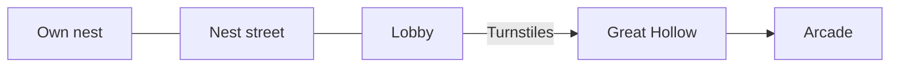
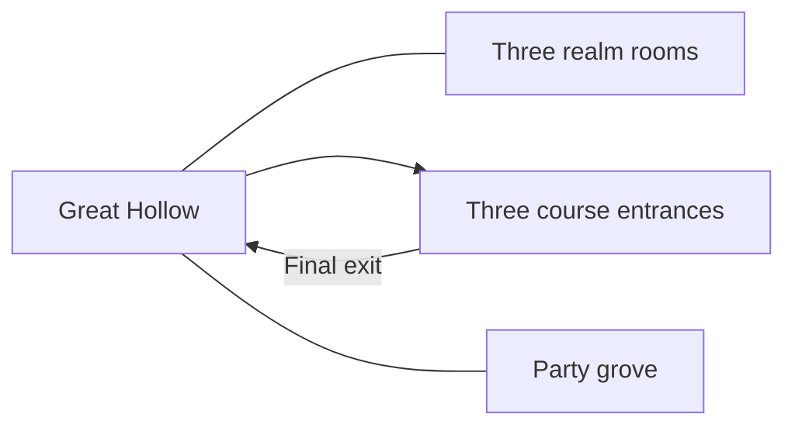

# Visitor routes and gathering-room audit

- Status: research draft for review
- Tickets: OP-060, OP-061, OP-128, OP-152
- Author: Codex
- Reviewer: Claude Duet
- Verified against the room data on main at `bddd299`, 2026-11-09
- Source: `packages/shared/rooms/index.ts`, `packages/shared/rooms/hollowHall.ts`, `packages/shared/src/doorways.ts`, and `apps/park/src/main.ts`

The map grid in [MAP.md](MAP.md) describes map 2. Map 3 uses a different public route through the Great Hollow. The inventory below follows the map-3 door resolver from the lobby. It describes room connections in code. Keepers' switches, tickets, and the entries setting still determine which connections a visitor can use.

## Map 3 inventory

| Visitor space | Room IDs | Size in room pixels | How it connects |
| --- | --- | --- | --- |
| Lobby and gift shop | `lobby` | 3200 × 1350 | Connects the nest street and the turnstiles. The gate leads to the Great Hollow. |
| Nest street and private nests | `homes`, `nest-<id>` | Street 3200 × 1350 | Play opens the owl's own nest when available. Nest doors are resolved per owl. The street leads back to the lobby. |
| Great Hollow | `m3-hall` | 6400 × 2800 | The central hall connects the lobby, three realm rooms, three course entrances, the party grove, and the arcade. |
| Gathering grove | `grove` | 4800 × 1250 | Fishing and quest givers. Returns to the Great Hollow. |
| Neon street | `market` | 3200 × 1350 | Copy game, shops, and the arcade door. Returns to the Great Hollow. |
| Glass street | `glass` | 1600 × 1715 | Quest giver and solo climb portal. Returns to the Great Hollow. |
| Party grove | `hub` | 4800 × 1250 | Connects the three realm rooms and returns to the Great Hollow. |
| Arcade | `arcade` | 4800 × 1350 | Enter from the Great Hollow or neon street. The exit returns to the Great Hollow on map 3. |
| Canopy course | `canopy-1`, `canopy-roots`, `canopy-2a`, `canopy-2b`, `canopy-2c`, `canopy-3`, `canopy-hut` | Individual rooms 1600–6400 × 900 | Starts off the Great Hollow. The finishing hut returns there. |
| Circuit course | `circuit-1`, `circuit-2`, `circuit-3` | Individual rooms 3200–4800 × 900 | Starts off the Great Hollow. The final exit returns there. |
| Brushstroke course | `brush-1`, `brush-2`, `brush-falls`, `brush-3a`, `brush-3b` | Individual rooms 1600–4800 × 900 | The rim entrance opens the course. Its final exit returns to the Great Hollow. |

Map 1 still resolves the lobby gate to the original hub. Map 2 retains the level and stair routes in [MAP.md](MAP.md). An arrival assigned map 2 normally walks map 3 unless the visit requests the old map. Old links can also resolve to a replacement room through the folded-room table. Keep those distinctions in QA so passing a map-1 arch does not stand in for passing the map-3 turnstiles.

## How a visitor reads the park

Add a future realm from a distinct rim landmark with a way back to the same arrival. A course can branch from that landmark and return to the Hollow after its payoff. The unused realm slot can gain its own visitor room without moving the existing course entry. Keep planned spaces out of the travel list until their routes exist. Reserve further space in the layout without adding active doors.

The existing Menu Map already gives visitors a way home and a way to revisit places they have reached. Test whether the Great Hollow signs and the existing map are sufficient before drawing a separate map screen. A revised screen or new visitor-facing labels can be reviewed in its own ticket.

## Where more height helps

- **Gathering rooms.** The Great Hollow already has the strongest top-down gathering layout. Seven painted rooms also gained deep plaza floors. Start with wayfinding and reachability on those floors before extending them again. Walk the far rim, cross the middle, and verify every doorway and activity can be reached with the phone controls visible.
- **Corridors and courses.** Keep the nest street's through-route legible and retain directional side-view course sections where height is part of the challenge. Use room transitions to add a new area when it needs a separate landmark or return route.
- **First candidate if more depth is needed.** Review the gathering grove first. Its arrivals, pond, quest givers, and return route already exercise both axes. Reuse its current floor and landmarks for a code-only preview. The first walk-through uses existing assets and costs $0 in art. If it exposes a gap, draft a Build ticket for the camera, floor, doorways, spawn, and NPC changes, and a separate art ticket with a screen count and estimate before any painted extension.
- **Visitor limits.** Floor area alone does not change server capacity. Check phone camera framing, occlusion, reachable exits, and the existing room capacity test before proposing a cap change.

The first follow-up is a map-3 walk from the gate to each Great Hollow entrance and back on portrait and landscape. Record dead ends, ambiguous labels, and any camera or control overlap. The last local OP-095 matrix confirmed that the tall hall left the controls visible at four Chromium viewport sizes. Physical-device safe areas and the live-map walk remain separate checks.
