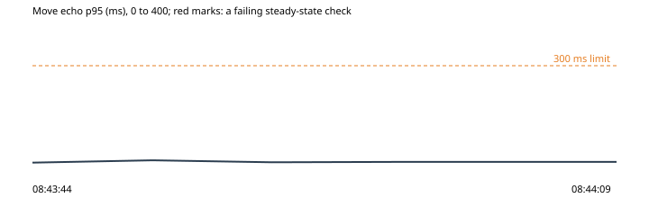

# 6. A visitor's clock 10 minutes fast

Run `2026-10-30-clock-skew-2`, this machine: the park under wrangler dev on port 8797, the stand-in store on port 8791, 2026-10-30T08:43:24.806Z to 2026-10-30T08:44:09.240Z. Park 0d2cec6, harness 0d2cec6.

**Hypothesis.** A page whose clock runs 10 minutes fast comes into the hub with its pass, and draws the other owls walking as a page on the right time does, never jumping to where they are going.

**Verdict: held.** Abort fired: no. Rollback confirmed: yes.

**Blast radius.** Two scripted pages in the throwaway park, one after the other: one on the right time, one with its own clock set ahead.

**Rollback.** async rollback(ctx) {
    await Promise.all((ctx.state.contexts ?? []).map((c) => c.close().catch(() => undefined)));
  }

## What the harness saw

- As expected: a page 10 minutes fast, into the hub by address: online in 1130 ms, its clock 600 s ahead (08:43:55)
- As expected: the others' walks as the fast page draws them: fast page: 162 looks at an owl mid-walk, 0 jumps in 48 looks; a page on the right time: 140 and 0 in 48 (08:44:03)

## The steady state through the run

| Time | Phase | Health | Latency p95 | Errors | Checkout | Journey |
| --- | --- | --- | --- | --- | --- | --- |
| 08:43:44 | before | ok (200) | ok (9 ms) | ok (0%) | ok (47 ms) | ok (1845 ms) |
| 08:43:49 | experiment | ok (200) | ok (16 ms) | ok (0%) | - | - |
| 08:43:54 | experiment | ok (200) | ok (10 ms) | ok (0%) | - | - |
| 08:43:59 | experiment | ok (200) | ok (11 ms) | ok (0%) | - | - |
| 08:44:09 | after | ok (200) | ok (11 ms) | ok (0%) | ok (52 ms) | ok (1931 ms) |

## Proposed tickets

None. (proposed-tickets.json; the QA agent reviews and files them.)
