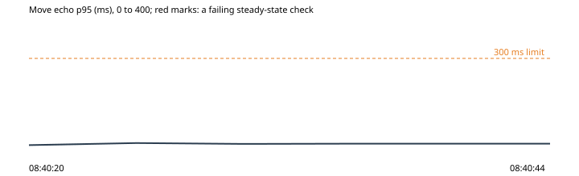

# 6. A visitor's clock 10 minutes fast

Run `2026-10-30-clock-skew`, this machine: the park under wrangler dev on port 8797, the stand-in store on port 8791, 2026-10-30T08:40:00.505Z to 2026-10-30T08:40:44.550Z. Park 0d2cec6, harness 0d2cec6.

**Hypothesis.** A page whose clock runs 10 minutes fast comes into the hub with its pass, and draws the other owls walking as a page on the right time does, never jumping to where they are going.

**Verdict: held.** Abort fired: no. Rollback confirmed: yes.

**Blast radius.** Two scripted pages in the throwaway park, one after the other: one on the right time, one with its own clock set ahead.

**Rollback.** async rollback(ctx) {
    await Promise.all((ctx.state.contexts ?? []).map((c) => c.close().catch(() => undefined)));
  }

## What the harness saw

- As expected: a page 10 minutes fast, into the hub by address: online in 1163 ms, its clock 600 s ahead (08:40:30)
- As expected: the others' walks as the fast page draws them: fast page: 160 looks at an owl mid-walk, 0 jumps in 50 looks; a page on the right time: 170 and 0 in 49 (08:40:38)

## The steady state through the run

| Time | Phase | Health | Latency p95 | Errors | Checkout | Journey |
| --- | --- | --- | --- | --- | --- | --- |
| 08:40:20 | before | ok (200) | ok (7 ms) | ok (0%) | ok (54 ms) | ok (1667 ms) |
| 08:40:25 | experiment | ok (200) | ok (14 ms) | ok (0%) | - | - |
| 08:40:30 | experiment | ok (200) | ok (11 ms) | ok (0%) | - | - |
| 08:40:35 | experiment | ok (200) | ok (12 ms) | ok (0%) | - | - |
| 08:40:44 | after | ok (200) | ok (12 ms) | ok (0%) | ok (42 ms) | ok (1895 ms) |

## Proposed tickets

None. (proposed-tickets.json; the QA agent reviews and files them.)
