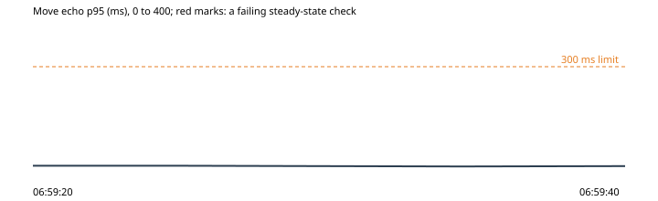

# 7. One visitor floods the room with emotes

Run `2026-10-30-emote-flood`, this machine: the park under wrangler dev on port 8797, the stand-in store on port 8791, 2026-10-30T06:59:00.898Z to 2026-10-30T06:59:40.905Z. Park b9daa6a, harness b9daa6a.

**Hypothesis.** A visitor sending 50 emotes a second is throttled (its extra emotes dropped, then its socket closed), and nobody else in the room lags or loses a move (OP-089).

**Verdict: held.** Abort fired: no. Rollback confirmed: yes.

**Blast radius.** One extra scripted visitor in the throwaway park's hub, flooding for 10 s at most.

**Rollback.** async rollback(ctx) {
    await ctx.state.flooder?.leave();
  }

## What the harness saw

- As expected: the flood's emotes the others saw played: 1 of 41 sent over 836 ms (06:59:35)
- As expected: the flooding socket closed by the room: after 836 ms and 41 emotes: code 4003 (too many frames) (06:59:35)
- As expected: the others' move echo p95 from the flood's start: 6 ms (73 moves) (06:59:35)
- As expected: moves the others lost from the flood's start: 0 of 73 (06:59:35)

## The steady state through the run

| Time | Phase | Health | Latency p95 | Errors | Checkout | Journey |
| --- | --- | --- | --- | --- | --- | --- |
| 06:59:20 | before | ok (200) | ok (7 ms) | ok (0%) | ok (44 ms) | ok (1116 ms) |
| 06:59:25 | experiment | ok (200) | ok (7 ms) | ok (0%) | - | - |
| 06:59:30 | experiment | ok (200) | ok (6 ms) | ok (0%) | - | - |
| 06:59:35 | experiment | ok (200) | ok (5 ms) | ok (0%) | - | - |
| 06:59:40 | after | ok (200) | ok (6 ms) | ok (0%) | ok (34 ms) | ok (1110 ms) |

## Proposed tickets

None. (proposed-tickets.json; the QA agent reviews and files them.)
