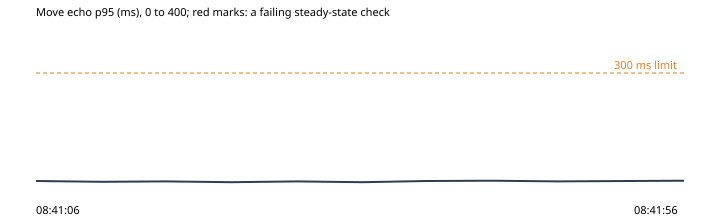

# 8. The collection log’s database unreachable

Run `2026-10-30-log-sink-down`, this machine: the park under wrangler dev on port 8797, the stand-in store on port 8791, 2026-10-30T08:40:46.376Z to 2026-10-30T08:41:56.477Z. Park 0d2cec6, harness 0d2cec6.

**Hypothesis.** With the collection log down, new owls still get their starter pack at once, and its rows wait in the outbox and reach the log once it is back, each once (OP-107).

**Verdict: held.** Abort fired: no. Rollback confirmed: yes.

**Blast radius.** The throwaway park's collection log only (sent to the stand-in store in place of the log function), and five new scripted visitors.

**Rollback.** async rollback(ctx) {
    if (ctx.state.down) await storeFault(ctx.park, { clear: true });
    await Promise.all((ctx.state.newcomers ?? []).map((v) => v.leave()));
  }

## What the harness saw

- As expected: new owls in with their starter pack while the log was down: 5 of 5 played their first emote (08:41:08)
- As expected: the log while it was down: 11 sends refused, 0 starter rows taken (08:41:26)
- As expected: the starter-pack rows once the log was back: 20 new owls' rows taken (at least the 15 of their starter packs), 24 s after it came back; 0 rows sent twice (08:41:50)

## The steady state through the run

| Time | Phase | Health | Latency p95 | Errors | Checkout | Journey |
| --- | --- | --- | --- | --- | --- | --- |
| 08:41:06 | before | ok (200) | ok (8 ms) | ok (0%) | ok (43 ms) | ok (1999 ms) |
| 08:41:11 | experiment | ok (200) | ok (6 ms) | ok (0%) | - | - |
| 08:41:16 | experiment | ok (200) | ok (7 ms) | ok (0%) | - | - |
| 08:41:21 | experiment | ok (200) | ok (5 ms) | ok (0%) | - | - |
| 08:41:26 | experiment | ok (200) | ok (7 ms) | ok (0%) | - | - |
| 08:41:31 | experiment | ok (200) | ok (5 ms) | ok (0%) | - | - |
| 08:41:36 | experiment | - | - | - | ok (36 ms) | - |
| 08:41:36 | experiment | ok (200) | ok (8 ms) | ok (0%) | - | - |
| 08:41:41 | experiment | ok (200) | ok (9 ms) | ok (0%) | - | - |
| 08:41:46 | experiment | ok (200) | ok (7 ms) | ok (0%) | - | - |
| 08:41:56 | after | ok (200) | ok (9 ms) | ok (0%) | ok (47 ms) | ok (1938 ms) |

## Proposed tickets

None. (proposed-tickets.json; the QA agent reviews and files them.)
