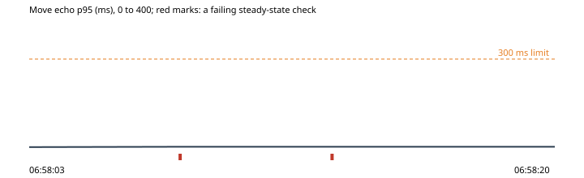

# 1. The room server killed mid-session

Run `2026-10-30-room-server-killed`, this machine: the park under wrangler dev on port 8797, the stand-in store on port 8791, 2026-10-30T06:57:44.155Z to 2026-10-30T06:58:20.769Z. Park b9daa6a, harness b9daa6a.

**Hypothesis.** Every visitor in a room is back in within 10 s of the room server returning, its owl where it stood (OP-087).

**Verdict: failed.** Abort fired: no. Rollback confirmed: yes.

**Blast radius.** This machine's throwaway park only: its Worker and room server process, killed and kept down for 3 s; the stand-in store and the scripted visitors carry on.

**Rollback.** async rollback(ctx) {
    if (!ctx.state.down) return;
    await ctx.park.restart();
    ctx.state.down = false;
  }

## What the harness saw

- As expected: visitors back in after the room server returned: 10 of 10 (06:58:14)
- As expected: the slowest visitor back, from the room server returning: 2218 ms (06:58:14)
- **Not as expected**: owls let back in more than 60 px from where they stood: 8 of 10 (furthest 561 px) (06:58:14)

## The steady state through the run

| Time | Phase | Health | Latency p95 | Errors | Checkout | Journey |
| --- | --- | --- | --- | --- | --- | --- |
| 06:58:03 | before | ok (200) | ok (6 ms) | ok (0%) | ok (41 ms) | ok (992 ms) |
| 06:58:08 | experiment | **failing** (ECONNREFUSED) | ok (7 ms) | ok (0%) | - | - |
| 06:58:13 | experiment | ok (200) | **failing** (- ms) | **failing** (0%) | - | - |
| 06:58:20 | after | ok (200) | ok (7 ms) | ok (0%) | ok (61 ms) | ok (1110 ms) |

## Proposed tickets

- PATCH: room server: owls let back in more than 60 px from where they stood (proposed-tickets.json; the QA agent reviews and files them.)
