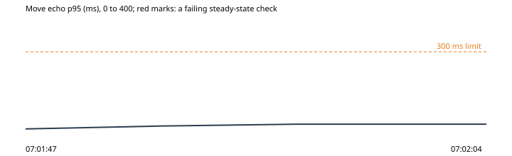

# 4. The hub filled to its cap, then one more

Run `2026-10-30-rooms-full-2`, this machine: the park under wrangler dev on port 8797, the stand-in store on port 8791, 2026-10-30T07:01:28.244Z to 2026-10-30T07:02:04.420Z. Park b9daa6a, harness b9daa6a.

**Hypothesis.** With the line set to start by itself, filling the hub to its 80 owls puts the next visitor in the line with the busy ribbon on, and nobody already inside lags (OP-075, OP-088).

**Verdict: failed.** Abort fired: no. Rollback confirmed: yes.

**Blast radius.** The throwaway park's hub: 70 more scripted visitors beside the fleet's 10, then two more; the line's setting changed for the run and put back.

**Rollback.** async rollback(ctx) {
    await Promise.all((ctx.state.crowd ?? []).map((v) => v.leave()));
    if (ctx.state.lineChanged) await ctx.admin('capacity', { line: LINE_AS_DEPLOYED, ribbon: { on: false, words: null } });
  }

## What the harness saw

- As expected: owls in the hub before the newcomers: 80 (07:01:49)
- **Not as expected**: a newcomer as the hub filled: turned away: code 4010 (room full) (07:01:49)
- As expected: a newcomer 9 s later, once the line has counted the park: sent to the line (4012): waiting, place 1 (07:01:58)
- As expected: the busy ribbon: It's busy tonight; things may be slow (07:01:58)
- As expected: move echo p95 inside while the hub filled: 24 ms (53 moves) (07:01:58)
- As expected: moves lost inside while the hub filled: 0 of 53 (07:01:58)

## The steady state through the run

| Time | Phase | Health | Latency p95 | Errors | Checkout | Journey |
| --- | --- | --- | --- | --- | --- | --- |
| 07:01:47 | before | ok (200) | ok (6 ms) | ok (0%) | ok (44 ms) | ok (1098 ms) |
| 07:01:52 | experiment | ok (200) | ok (17 ms) | ok (0%) | - | - |
| 07:01:57 | experiment | ok (200) | ok (24 ms) | ok (0%) | - | - |
| 07:02:04 | after | ok (200) | ok (24 ms) | ok (0%) | ok (33 ms) | ok (1163 ms) |

## Proposed tickets

- PATCH: overflow: a newcomer as the hub filled (proposed-tickets.json; the QA agent reviews and files them.)
