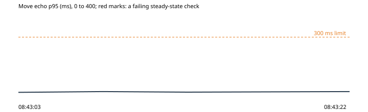

# 5. One phone on a 3G network

Run `2026-10-30-slow-phone-2`, this machine: the park under wrangler dev on port 8797, the stand-in store on port 8791, 2026-10-30T08:42:43.292Z to 2026-10-30T08:43:22.957Z. Park 0d2cec6, harness 0d2cec6.

**Hypothesis.** A phone on 3G comes into the hub and can play (its owl walks, the others are there), and the load screen's bar shows the bytes as they come: it only grows, in steps, while the park loads (OP-129).

**Verdict: held.** Abort fired: no. Rollback confirmed: yes.

**Blast radius.** One scripted phone page in the throwaway park, its network and processor slowed.

**Rollback.** async rollback(ctx) {
    await ctx.state.context?.close();
  }

## What the harness saw

- As expected: a phone on 3G into the hub by address: online in 12.3 s (08:43:15)
- As expected: the load screen's bar while the phone loaded: 14 steps between empty and full, 0 back, up to 100%, up 9.7 s (08:43:15)
- As expected: the phone on 3G at play: its owl walked where it was told, 10 other owls in view of the room (08:43:16)

## The steady state through the run

| Time | Phase | Health | Latency p95 | Errors | Checkout | Journey |
| --- | --- | --- | --- | --- | --- | --- |
| 08:43:03 | before | ok (200) | ok (7 ms) | ok (0%) | ok (48 ms) | ok (1850 ms) |
| 08:43:08 | experiment | ok (200) | ok (11 ms) | ok (0%) | - | - |
| 08:43:13 | experiment | ok (200) | ok (8 ms) | ok (0%) | - | - |
| 08:43:22 | after | ok (200) | ok (11 ms) | ok (0%) | ok (52 ms) | ok (1883 ms) |

## Proposed tickets

None. (proposed-tickets.json; the QA agent reviews and files them.)
