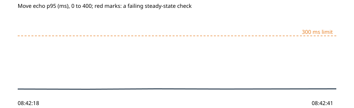

# 3. The store's webhook answered 500, then too late

Run `2026-10-30-webhook-dropped-2`, this machine: the park under wrangler dev on port 8797, the stand-in store on port 8791, 2026-10-30T08:41:58.345Z to 2026-10-30T08:42:41.428Z. Park 0d2cec6, harness 0d2cec6.

**Hypothesis.** A paid-order webhook the Worker fails (a 500, or no answer in the 5 s the store waits) is sent again by the store, and the order gets its one ticket and one claim-link email, never two.

**Verdict: held.** Abort fired: no. Rollback confirmed: yes.

**Blast radius.** Two orders in the stand-in store, and the throwaway park's answers about them; nothing else the store answers is touched.

**Rollback.** async rollback(ctx) {
    if (ctx.state.faulted) await storeFault(ctx.park, { clear: true });
  }

## What the harness saw

- As expected: order A's first delivery, the store failing: HTTP 500 {"error":"try again"} in 20 ms (08:42:19)
- As expected: order A sent again, then once more: HTTP 200 {"tickets":1,"sent":true} in 33 ms; HTTP 200 {"tickets":1,"sent":true} in 21 ms; emails 1 (08:42:19)
- As expected: order B's first delivery, the store's answer held back: no answer within 5 s (08:42:35)
- As expected: order B sent again while the first delivery was still at work, then once more: HTTP 200 {"tickets":1,"sent":true} in 3079 ms; HTTP 200 {"tickets":1,"sent":true} in 21 ms; emails 1 (08:42:35)

## The steady state through the run

| Time | Phase | Health | Latency p95 | Errors | Checkout | Journey |
| --- | --- | --- | --- | --- | --- | --- |
| 08:42:18 | before | ok (200) | ok (7 ms) | ok (0%) | ok (42 ms) | ok (1956 ms) |
| 08:42:23 | experiment | ok (200) | ok (6 ms) | ok (0%) | - | - |
| 08:42:28 | experiment | ok (200) | ok (8 ms) | ok (0%) | - | - |
| 08:42:33 | experiment | ok (200) | ok (7 ms) | ok (0%) | - | - |
| 08:42:41 | after | ok (200) | ok (8 ms) | ok (0%) | ok (28 ms) | ok (2017 ms) |

## Proposed tickets

None. (proposed-tickets.json; the QA agent reviews and files them.)
