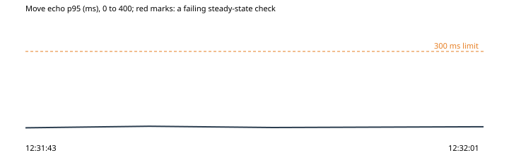

# 9. A visitor's page worked from the console, to put its owl somewhere it cannot walk

Run `2026-10-31-teleport-from-console`, this machine: the park under wrangler dev on port 8797, the stand-in store on port 8791, 2026-10-31T12:31:17.833Z to 2026-10-31T12:32:01.860Z. Park af36264, harness af36264.

**Hypothesis.** Whatever a page sends from its console, the other visitors never see its owl off the floor or standing in mid-air, the room logs what it would not take (position_rejected), and a page that keeps asking for walks out of the room is closed (OP-149).

**Verdict: held.** Abort fired: no. Rollback confirmed: yes.

**Blast radius.** Three extra scripted visitors in the throwaway park's hub, one at a time, for half a minute.

**Rollback.** async rollback(ctx) {
    for (const v of ctx.state.visitors ?? []) await v.leave();
  }

## What the harness saw

- As expected: places the fleet was told the console's owls are at or walking to: 40 told, 0 off the floor (12:31:55)
- As expected: standing in mid-air told to the fleet: not told (12:31:55)
- As expected: the page that asked for walks out of the room: closed: code 4003 (too many moves) (12:31:55)
- As expected: where the hub let in a page that said it was at its far end: 142 px from the spawn, 2466 px from where it said (12:31:55)
- As expected: a hello from (9999, 9999): refused: 4002 (12:31:55)

## The steady state through the run

| Time | Phase | Health | Latency p95 | Errors | Checkout | Journey |
| --- | --- | --- | --- | --- | --- | --- |
| 12:31:43 | before | ok (200) | ok (7 ms) | ok (0%) | ok (57 ms) | ok (2712 ms) |
| 12:31:48 | experiment | ok (200) | ok (13 ms) | ok (0%) | - | - |
| 12:31:53 | experiment | ok (200) | ok (8 ms) | ok (0%) | - | - |
| 12:32:01 | after | ok (200) | ok (11 ms) | ok (0%) | ok (36 ms) | ok (2579 ms) |

## Proposed tickets

None. (proposed-tickets.json; the QA agent reviews and files them.)
